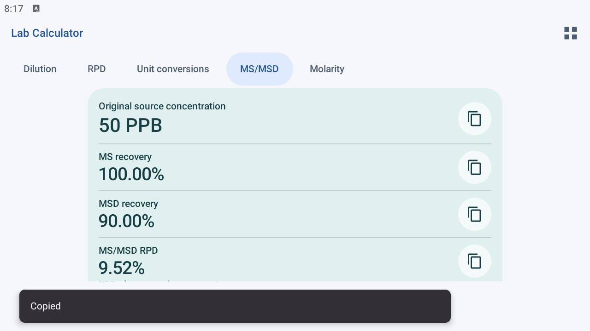

# Lab Calculator

Lab Calculator is an offline Android app that brings a handful of everyday laboratory calculations together in one place.

I’m an analyst at an environmental sciences laboratory, and I started this project to make calculations I use at work a little easier to work through and check. Each calculator shows its units and calculation steps, so the result isn’t just a number on a screen.

The app requires Android 7.0 or newer and works without an account or internet connection.

## Download and install

**v1.1.0 is still a draft and is not available as a public release yet.** The latest public download is [v1.0.2 Preview 1](https://github.com/DyFl/LabCalculator/releases/tag/v1.0.2-preview.1), which predates the redesign and newer unit-handling features shown here.

[Download the v1.0.2 Preview 1 APK](https://github.com/DyFl/LabCalculator/releases/download/v1.0.2-preview.1/LabCalculator-v1.0.2-preview.1.apk). Choose the APK rather than a source-code archive. Open it from your phone’s Files app and allow installation from that source if Android prompts you. The release also includes a `SHA256SUMS.txt` checksum file.

If you already have Lab Calculator installed, read [Updates and signing](#updates-and-signing) before installing. **The 1.0.0 preview uses a different signing certificate and cannot be updated in place with the newer APKs.**

## Screenshots

These screenshots show the redesigned **v1.1.0 release candidate** on an Android 9 emulator. The currently published 1.0.2 preview has the earlier interface.

[More screenshots, including portrait and dark-theme views](docs/instrument-design.md#current-screenshots) · [Release notes and screenshot details](docs/releases/1.1.0.md)

## Five calculators

| Calculator | What it helps you work out |
| --- | --- |
| Dilution | How much stock solution to use for a target concentration and final solution volume. |
| Relative percent difference (RPD) | The difference between a sample result and its replicate, expressed as a percentage. |
| Unit conversions | Metric mass, volume, and concentration conversions within a category. |
| Matrix spike / matrix spike duplicate (MS/MSD) | Source concentration, spike recoveries, and RPD of the measured MS/MSD results. |
| Molarity / mass | How much reagent to weigh from the desired molarity, final volume, and formula weight. |

Copy results with their units or expand the calculation steps to check the working. Editing an input clears its previous result.

Named presets let you reuse preparation settings without storing sample results or calculation history. In MS/MSD, **Next sample** clears the measurements and results while keeping the preparation settings. Presets stay on the device and are lost if app data is cleared or the app is uninstalled.

## Using the app

Lab Calculator has been tested extensively, but no software is perfect. Before relying on a result, verify the calculation and make sure it’s appropriate for your method and laboratory procedures. Users are responsible for validating the app for their intended use and using it at their own risk.

Each calculator has assumptions about its inputs and how results are displayed. For example, dilution uses the final solution volume, and MS/MSD assumes the spike was added after dilution. Read the [calculation assumptions, rounding policies, and input limits](docs/calculation-assumptions.md) before using the app for a method.

## Testing

Release preparation passed 100 JVM tests and the complete 57-test Android suite on both Android 9 and a Pixel 9 Pro running Android 17. A separate check of the optimized APK covered all five calculators, copying, presets, Next sample, and state restoration. Builds and lint completed with no lint errors.

Earlier test failures and separate reruns remain documented. Device coverage is limited; TalkBack and Android 7 device checks remain outstanding. Automated tests do not establish suitability for every laboratory method. See the [detailed verification history](docs/verification.md) and [v1.1.0 release record](docs/releases/1.1.0.md) for results, warnings, and limitations.

## Updates and signing

The v1.1.0 candidate retains the signing certificate used by the published 1.0.1 and 1.0.2 previews. Its package and higher version code are compatible with in-place updates that keep app storage and presets. It is optimized and non-debuggable, but the certificate is the historical Android debug certificate retained for update compatibility.

**Published preview 1.0.0 has a different certificate.** Do not uninstall it or clear its data to work around an update failure if you need its saved state. No automatic migration between those certificates is provided.

A locally built APK may use a different key, so do not assume it can update a published installation. Signing credentials are not stored in this repository. See the [build and signing guidance](docs/technical-information.md#build-from-source).

## Technical details and feedback

The app is written in Kotlin with Jetpack Compose. [Technical information](docs/technical-information.md) covers building from source, storage, and CI. The [audit record](docs/audit.md) contains calculation checks and earlier findings.

To report a problem, include the calculator, app version, units, example inputs, and expected result. Use synthetic examples and leave out client, sample, or other confidential information.
