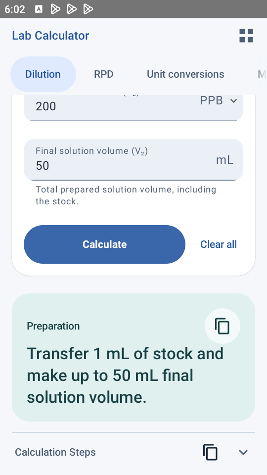

# Lab Calculator

An offline Android app for dilution preparation, replicate comparisons, spike recovery, unit conversions, and reagent mass calculations.

I'm Dylan Lara, an environmental laboratory Analyst III with more than seven years of progressive laboratory experience. I started this personal project to bring calculations I encounter at work into one place, with clear units, visible working, and useful checks on the inputs. It reflects the same habits I use in instrument troubleshooting and QA/QC: checking assumptions, investigating unexpected results, and documenting what changed.

The app has five calculators, copyable results, and saved preparation presets. Automated tests cover calculations and common input and workflow errors. **It is a calculation aid: check results against your laboratory's approved SOPs and QA system before use.**

## Features

| Tool | Laboratory workflow |
| --- | --- |
| Dilution | Calculate stock volume from stock concentration, target concentration, and final solution volume. |
| Relative percent difference (RPD) | Compare a sample result with its replicate on the same units and basis. |
| Unit conversions | Convert metric mass, volume, or mass concentration within a category. |
| Matrix spike / matrix spike duplicate (MS/MSD) | Calculate original-source concentration, spike recoveries, and RPD of measured MS/MSD concentrations. |
| Molarity / mass | Calculate reagent mass from molarity, final volume, and the reagent's formula weight. |

Results include units and expandable calculation steps. Editing an input clears its old result. Local presets reuse preparation settings without storing sample results; MS/MSD's **Next sample** keeps preparation settings while clearing measurements. The app works without an account, analytics, or internet permission. Android 7.0 or newer is required.

## Published download and development status

| Version or source | What is available |
| --- | --- |
| [Published v1.0.2 Preview 1](https://github.com/DyFl/LabCalculator/releases/tag/v1.0.2-preview.1) | Debug-signed Android APK with all five calculators, presets, result copying, and calculation steps. Release notes report 68 JVM tests and 12 Android tests passed. |
| `main`, reviewed at [`83bd243`](https://github.com/DyFl/LabCalculator/commit/83bd2433db2c477b6726d8b8ebcea1147e8455f5) | Later source adds explicit mg/L and µg/L handling in Dilution and MS/MSD, quantity-preserving unit changes, transfer instructions, and workflow improvements. Records report 100 JVM tests and 48 Android tests passed. These changes are not in the published APK. |
| [November source preview](https://github.com/DyFl/LabCalculator/tree/71b4733906c618cd342c5a150fc865e422a40a89) | Separate `codex/instrument-ui-preview` branch with redesigned screens and responsiveness work. Records report 100 JVM tests and a final 57-test Android 9 pass. The full Android 17 run did not pass; details are in [verification](docs/verification.md). No APK was published for this branch. |

These are **documented results for specific revisions**, not tests rerun for this README update. The earlier 54-test result belongs to the November design checkpoint, before three responsiveness tests were added. [Verification history and limits](docs/verification.md) keeps those checkpoints separate.

## Screenshots

**Unreleased November development build**, captured on BlueStacks Android 9 on November 14, 2026, at 360 dp width and normal text size. These genuine captures show the dilution inputs and the resulting preparation instruction. They do **not** show the published APK or the interface currently on `main`.

 

[More November screenshots and design notes](https://github.com/DyFl/LabCalculator/blob/71b4733906c618cd342c5a150fc865e422a40a89/docs/instrument-design.md#current-screenshots) · [Earlier September interface](docs/ui-polish.md#screenshots)

## Quality and verification

The calculation code uses decimal and rational arithmetic, with display rounding handled separately. Tests cover expected results, invalid and oversized inputs, zero-average RPD, unit-family compatibility, preset handling, stale-result clearing, and state restoration. The development notes record defects found during review and the checks added for them.

Test counts do not establish laboratory validation or regulatory approval. Device coverage is limited, TalkBack checks remain outstanding, and the November branch still needs an uninterrupted full-suite pass on Android 17. See [verification](docs/verification.md) for evidence and [development follow-up](docs/development-follow-up.md) for remaining work.

## Installation

Download [LabCalculator-v1.0.2-preview.1.apk](https://github.com/DyFl/LabCalculator/releases/download/v1.0.2-preview.1/LabCalculator-v1.0.2-preview.1.apk) from the release assets, open it on an Android 7.0+ device, and allow installation from that source if prompted. Choose the APK, not a source-code archive. The release includes `SHA256SUMS.txt`.

This is a **debug-signed preview for evaluation**. It can update the published v1.0.1 preview directly. The published v1.0.0 preview used a different certificate and requires uninstalling first; record any needed inputs before doing so, because uninstalling clears local state. Local builds may use another signing key: see [build and signing guidance](docs/technical-information.md#build-from-source).

## Calculation assumptions and limits

- Dilution uses **final solution volume**, including the stock. PPM/PPB and mg/L/µg/L are separate families; the newer source does not assume a density or equate PPM with mg/L.
- MS/MSD assumes **spiking after dilution**, uncorrected measurements on the same basis, and negligible spike volume. Its RPD compares measured concentrations, not percent recoveries. No automatic QC acceptance limits are applied.
- RPD is undefined at zero average. Signed values, near-zero results, and non-detects require the applicable method's rules.
- Molarity uses the actual reagent's formula weight, including hydration; no purity correction is applied.
- Display digits do not represent measurement uncertainty or equipment capability. Non-detect qualifiers are not numeric inputs.

Read the [full calculation assumptions, rounding policies, and input limits](docs/calculation-assumptions.md) before evaluating the app. It is not an EPA-approved method or a validated laboratory information system.

## Technical information and development

Written in Kotlin with Jetpack Compose. [Technical notes](docs/technical-information.md) cover project structure, local storage, source builds, and CI; the [audit record](docs/audit.md) preserves the calculation checks and earlier findings.

I use AI-assisted development tools for implementation and troubleshooting while learning the software side of this project. My laboratory experience guides the workflows, calculation assumptions, testing priorities, and review of results. This is a personal project, not an employer product or endorsement.

To report a problem, include the calculator, app version or source revision, units, example inputs, and expected result. Use synthetic examples and leave out client, sample, or other confidential information.
