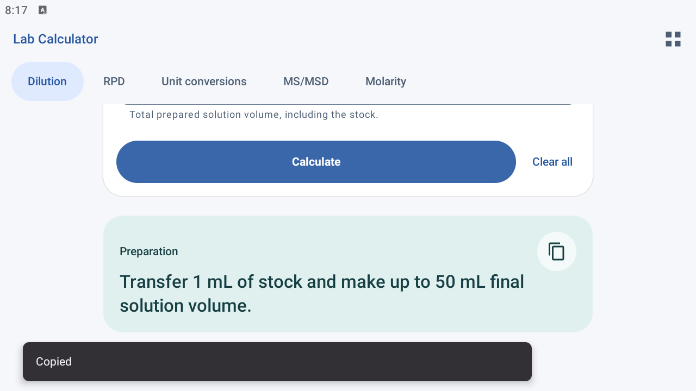

# Lab Calculator

An offline Android app for dilution preparation, replicate comparisons, spike recovery, unit conversions, and reagent mass calculations.

I'm Dylan Lara, an environmental laboratory Analyst III with more than seven years of progressive laboratory experience. I started this personal project to bring calculations I encounter at work into one place, with clear units, visible working, and useful checks on the inputs. It reflects the same habits I use in instrument troubleshooting and QA/QC: checking assumptions, investigating unexpected results, and documenting what changed.

The app has five calculators, copyable results, and saved preparation presets. Automated tests cover calculations and common input and workflow errors. **It is a calculation aid: check results against your laboratory's approved SOPs and QA system before use.**

## Features

| Tool | Laboratory workflow |
| --- | --- |
| Dilution | Calculate stock volume from stock concentration, target concentration, and final solution volume. |
| Relative percent difference (RPD) | Compare a sample result with its replicate on the same units and basis. |
| Unit conversions | Convert metric mass, volume, or mass concentration within a category. |
| Matrix spike / matrix spike duplicate (MS/MSD) | Calculate original-source concentration, spike recoveries, and RPD of measured MS/MSD concentrations. |
| Molarity / mass | Calculate reagent mass from molarity, final volume, and the reagent's formula weight. |

Results include units and expandable calculation steps. Editing an input clears its old result. Local presets reuse preparation settings without storing sample results; MS/MSD's **Next sample** keeps preparation settings while clearing measurements. The app works without an account, analytics, or internet permission. Android 7.0 or newer is required.

## Release status

| Version or source | What is available |
| --- | --- |
| **1.1.0 release candidate** | First full release prepared as a GitHub draft for review. Optimized, non-debuggable APK; version code 4. Not published yet. See [release notes and verification](docs/releases/1.1.0.md). |
| [Published v1.0.2 Preview 1](https://github.com/DyFl/LabCalculator/releases/tag/v1.0.2-preview.1) | Latest public download until 1.1.0 is approved. Debug-signed preview; it predates the redesigned interface and newer unit/dilution workflows. |

The release candidate brings together the redesigned five-calculator interface, faster number entry, exact quantity-preserving unit changes, and clearer dilution instructions. No QC acceptance rules or new scientific formulas are introduced. [Verification history](docs/verification.md) distinguishes the historical Pixel failures from separate passing runs.

## Screenshots

**Optimized 1.1.0 release candidate**, captured on BlueStacks Android 9 at 1280 × 720 pixels, 240 dpi, and normal text size. These real, scrolled result views show the current optimized release UI; the release record identifies the final APK and checksum. The earlier portrait and dark-theme design captures remain available below.

[More November screenshots and design notes](docs/instrument-design.md#current-screenshots) · [Earlier September interface](docs/ui-polish.md#screenshots)

## Quality and verification

The calculation code uses decimal and rational arithmetic, with display rounding handled separately. Tests cover expected results, invalid and oversized inputs, zero-average RPD, unit-family compatibility, preset handling, stale-result clearing, and state restoration. The development notes record defects found during review and the checks added for them.

Test counts do not establish laboratory validation or regulatory approval. The release preparation passed the complete 57-test suite on Android 9 and on the Pixel 9 Pro / Android 17. Earlier failures, a first 56/57 Pixel attempt, and separate reruns remain documented; device coverage is limited and TalkBack checks remain outstanding. See [verification](docs/verification.md) for evidence and [development follow-up](docs/development-follow-up.md) for remaining work.

## Installation

Until the full release is approved, the public download remains [LabCalculator-v1.0.2-preview.1.apk](https://github.com/DyFl/LabCalculator/releases/download/v1.0.2-preview.1/LabCalculator-v1.0.2-preview.1.apk) from the release assets, open it on an Android 7.0+ device, and allow installation from that source if prompted. Choose the APK, not a source-code archive. The release includes `SHA256SUMS.txt`.

The 1.1.0 candidate uses the **same existing certificate** as published previews 1.0.1 and 1.0.2, with a higher version code, allowing in-place updates that retain presets. The APK is optimized and non-debuggable; its signer is the historical Android debug certificate retained for compatibility, not a newly created production key. Signing material is not stored in the repository.

Published preview 1.0.0 used a different certificate and cannot be updated in place by this APK. Do not uninstall or clear its data to work around that mismatch. Keep that installation if you need its state; no automatic migration is provided. Locally built APKs may use another key: see [build and signing guidance](docs/technical-information.md#build-from-source).

## Calculation assumptions and limits

- Dilution uses **final solution volume**, including the stock. PPM/PPB and mg/L/µg/L are separate families; the newer source does not assume a density or equate PPM with mg/L.
- MS/MSD assumes **spiking after dilution**, uncorrected measurements on the same basis, and negligible spike volume. Its RPD compares measured concentrations, not percent recoveries. No automatic QC acceptance limits are applied.
- RPD is undefined at zero average. Signed values, near-zero results, and non-detects require the applicable method's rules.
- Molarity uses the actual reagent's formula weight, including hydration; no purity correction is applied.
- Display digits do not represent measurement uncertainty or equipment capability. Non-detect qualifiers are not numeric inputs.

Read the [full calculation assumptions, rounding policies, and input limits](docs/calculation-assumptions.md) before evaluating the app. It is not an EPA-approved method or a validated laboratory information system.

## Technical information and development

Written in Kotlin with Jetpack Compose. [Technical notes](docs/technical-information.md) cover project structure, local storage, source builds, and CI; the [audit record](docs/audit.md) preserves the calculation checks and earlier findings.

I use AI-assisted development tools for implementation and troubleshooting while learning the software side of this project. My laboratory experience guides the workflows, calculation assumptions, testing priorities, and review of results. This is a personal project, not an employer product or endorsement.

To report a problem, include the calculator, app version or source revision, units, example inputs, and expected result. Use synthetic examples and leave out client, sample, or other confidential information.
