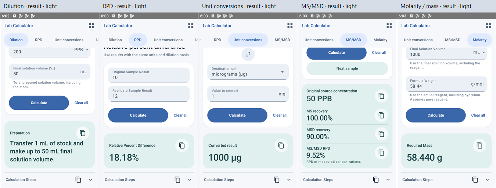
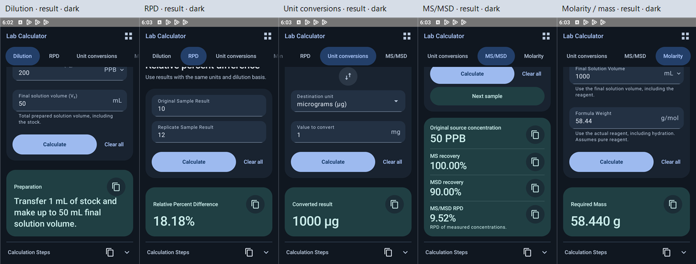

# Instrument design review — November 14, 2026

This redesign starts from local `main` at `83bd243`, not the older README pictures or release APK. The branch already had exact concentration conversions, dilution preparation instructions, robust preset status handling, and a compact MS/MSD summary. Those behaviors were retained.

The main issues in that source were competing outlines and similarly weighted panels, detailed reference material ahead of the task, weak separation between primary and secondary actions, and limited discovery of tools beyond the visible tabs. The shared components made a consistent redesign possible without rewriting the scientific workflows.

## Design and workflow

Cool blue controls, white or dark slate forms, and muted teal answers establish a calm scientific instrument. Filled fields replace repeated full outlines. A single bottom indicator, floating label, visible unit, and supporting error preserve the input affordance. Page titles, answers, and notes have distinct typographic roles. Forms use 24 dp corners, fields 14 dp, and actions a pill shape, with 1 dp form elevation. Content stops growing at 600 dp on wide displays. The native startup window also uses matching light/dark backgrounds.

Calculate is the dominant action; Clear all is a text action. Presets keep direct Load/Save actions with icons. A single preset menu would save little height and add a tap to repeated bench work, so both actions remain visible. Empty, unavailable, and unreadable storage messages and load/delete/save behavior are preserved. Save dialogs scroll at large text sizes.

Scrollable tabs retain one-tap access and edge cues. Filled selected pills are easier to distinguish than the previous underline. The optional **All calculators** grid button lists all five tools without a swipe; it does not replace the tabs or force an extra step. Separate calculator state and restoration remain intact. Switching calculator dismisses the previous keyboard.

Detailed **Formula and assumptions** disclosures follow the form and results. Essential guidance remains beside the inputs. Answers have selectable text, labelled 48 dp copy actions, and **Copied** feedback. **Calculation Steps** stays collapsible/selectable and gains a copy-all button including section headings and existing numbered working. Copying does not toggle expansion. Results scroll into view after keyboard dismissal, including the steps control when space permits. Oversized results start at their heading and remain scrollable. Invalid calculations reveal the first invalid numeric input.

Focused numeric inputs are brought into view again after keyboard resizing or a wrapped floating label changes height. IME Next continues through numeric fields, skipping unit selectors. Done calculates and gives focus to Calculate, preventing Android from reopening a different editor. MS/MSD's Next sample still focuses the cleared source measurement; its shorter **Measurements** heading fits above the source label and before-factor guidance at 320 dp with 1.5× text and the keyboard open.

| Calculator | Changes specific to its workflow |
| --- | --- |
| Dilution | Established and reviewed the system first in four states and both themes. Shorter basis guidance retains the PPM/PPB versus mg/L/µg/L distinction. C₁/C₂/V₂, final-volume guidance, the complete preparation instruction, units, approximation marks, and exact working are preserved. |
| RPD | Measurements lead directly to Calculate and a prominent percentage. The same-unit/dilution-basis reminder stays by the inputs; detailed signed-value and zero-average guidance remains expandable. |
| Unit conversions | Filled category/unit selectors and input, with the centered 48 dp Swap units retained. The result emphasizes the output and unit. Category reset, quantity-preserving starting-unit/swap behavior, and output-only destination selection are unchanged. |
| MS/MSD | Shorter title, accessible Preparation and Measurements headings, clearer spacing, and a tonal Next sample action. One answer panel uses a larger reconstructed-source value and smaller recovery/RPD rows. Individual copy actions, undefined-RPD explanation/disabled copy, the shared unit selector, and visible uncorrected-measurement/preparation assumptions remain. |
| Molarity / mass | Shorter heading, filled inputs, and a prominent grams result. Final-volume, hydration, and pure-reagent guidance stay beside the fields. Formula-weight/purity assumptions and five-significant-figure output are unchanged. |

Shared implementation lives in `ui/components` and `ui/theme`; no runtime dependency was added. Headings have accessibility semantics, results and blocked-unit messages use polite announcements, and controls retain at least 48 dp touch targets. Fields, actions, notes, and answers grow/wrap with larger text. Calculated contrast exceeds 4.5:1 for input text, supporting guidance, primary-action text, and result text in both themes; idle field indicators exceed 3:1 against their fill. Motion uses standard Compose transitions and Android's animation-duration scale; no repeating animation was introduced. Component previews include 360 dp light/dark contexts and 320 dp at 1.5× text; the review uses captures of running screens.

## Verification during the design pass

These results record the design pass before the three responsiveness regressions and Android 17 test-harness update. For current preview checks, physical Pixel measurements, the six initial Pixel UI failures, and the separate passing workflow-class rerun, see the [responsiveness report](responsiveness.md#verification).

The final offline Gradle run completed `testDebugUnitTest`, `assembleDebug`, `lintDebug`, and `assembleDebugAndroidTest`. All **100 JVM tests passed**. Lint reported **0 errors and 13 maintenance warnings** concerning existing dependencies, manifest/backup configuration, and unused resources.

The available device was BlueStacks running **Android 9 / API 28**. The final instrumentation runs used the production screens with isolated test preset storage:

| Width / text scale | Checks | Result | Local log |
| --- | --- | --- | --- |
| 360 dp / 1.3× | Complete Android suite | 54 passed | `build/instrument-design/accepted-360-1.3/tests.txt` |
| 320 dp / 1.5× | UI, units, presets, workflow, and redesign regressions; animations disabled | 31 passed | `build/instrument-design/accepted-320-1.5/tests.txt` |
| 320 dp / 2.0× | All-calculator UI/layout, navigation, and IME action checks; animations disabled | 4 passed | `build/instrument-design/accepted-320-2.0/tests.txt` |
| 360 dp / 1.0× | Final all-calculator UI checks and native captures, with invalid fields visible in error captures | 4 passed | `build/instrument-design/reviewed-360-1.0/tests.txt` |

The six new regressions cover dilution's four states in both themes, calculator-menu navigation with independent/restored inputs, first-error scrolling and stale-result removal, exact copy-all working without expansion, focus clearing when switching tools, and a focused numeric field remaining visible after its viewport shrinks. Existing UI coverage now explicitly checks Done in touch input mode, focus dismissal, wrapping, result visibility, and the first invalid field being visible on every calculator. The final capture run was repeated after correcting the error-photo framing; application code was unchanged.

All five calculators were visually reviewed in empty, populated, error, and result states in both themes. Real MainActivity keyboard checks at 320 dp / 1.5× exercised Dilution's numeric Next/Done path and MS/MSD's preparation-to-measurement path, Done/result visibility, and Next sample. An MS/MSD example with factor 1, spike 50, source 5, MS 55, and MSD 50 displayed 5 PPB, 100.00%, 90.00%, and 9.52%, respectively, with the keyboard dismissed.

BlueStacks' native instrumentation screenshot service crashed during an early narrow-screen capture. The final 320 dp runs disable only image capture with the test argument `captureScreenshots=false`; text-clipping, layout, workflow, state, and clipboard assertions still execute. The 360 dp screenshot captures and the separate MainActivity keyboard images use the running app. A controlled test host runs the automated IME actions; the real on-screen keyboard was inspected separately. Emulator size, density, font, motion, keyboard, and night settings were restored after inspection.

Generated logs/captures are under `build/instrument-design/`; build/test/lint reports are under `app/build/reports/`. The debug APK was built locally. No release signing or publishing was performed.

Calculation engines, numeric parsing, unit conversion logic, preset models/store, the main manifest, runtime dependencies, release signing, and release version are unchanged from `83bd243`. The later responsiveness work adds local optimized build variants and updates test-only dependencies. No QC pass/fail rules were added.

## Current screenshots

These are captures of running production Compose screens on the Android 9 emulator, not image mockups. The strips show Dilution, RPD, Unit conversions, MS/MSD, and Molarity / mass from left to right, at 360 dp width and 1.0× text. Long forms are scrolled to the state under review; they are not full-page composites.

| State | Light | Dark |
| --- | --- | --- |
| Empty | [All five](screenshots/instrument/empty-light.png) | [All five](screenshots/instrument/empty-dark.png) |
| Populated | [All five](screenshots/instrument/filled-light.png) | [All five](screenshots/instrument/filled-dark.png) |
| Error | [All five](screenshots/instrument/error-light.png) | [All five](screenshots/instrument/error-dark.png) |
| Result | [All five](screenshots/instrument/result-light.png) | [All five](screenshots/instrument/result-dark.png) |





Individual populated screens: [Dilution](screenshots/instrument/dilution-light.png), [RPD](screenshots/instrument/rpd-light.png), [Unit conversions](screenshots/instrument/unit-conversions-light.png), [MS/MSD](screenshots/instrument/ms-msd-light.png), [Molarity / mass](screenshots/instrument/molarity-mass-light.png). Dilution also has full-size [dark inputs](screenshots/instrument/dilution-dark.png), [light result](screenshots/instrument/dilution-result-light.png), and [dark result](screenshots/instrument/dilution-result-dark.png) captures.

Separate MainActivity captures at **320 dp and 1.5× text**, with the real numeric IME: [Dilution's final-volume input](screenshots/instrument/keyboard-dilution-320.png), [MS/MSD after Next sample](screenshots/instrument/keyboard-ms-next-sample-320.png), and [MS/MSD results after Done](screenshots/instrument/ms-results-320.png). The keyboard is visible in the first two and dismissed in the last. The keyboard's own appearance belongs to the emulator's installed IME.

## Remaining concerns

No scientific defect was found in this review or the executed unit tests. The operator must choose the correct parts-per basis. The app cannot infer density, measurement uncertainty, pipette capability, purity corrections, method-specific non-detect rules, or QC limits. These remain documented assumptions, not validation claims.

The later responsiveness pass exercised a physical Pixel 9 Pro on Android 17, and the user accepted its design and responsiveness in the optimized build. TalkBack navigation, other physical devices, Android versions, and IMEs still need separate hands-on checks. Decimal keyboards may not expose signs or an exponent key although the parser accepts signed values/scientific notation. Existing lint warnings about dependencies, backup configuration, redundant manifest labels, and unused resources are separate maintenance work; runtime dependency upgrades were kept outside this redesign.

## Try the current source

Open this checkout in Android Studio with JDK 17 and Android SDK 37, then run on your device or emulator. From PowerShell:

```powershell
.\gradlew.bat testDebugUnitTest assembleDebug lintDebug
```

The debug APK is `app/build/outputs/apk/debug/app-debug.apk`. Read the [local build and signing guidance](responsiveness.md#safely-try-local-builds) before installing over an existing app; the separate Performance build has independent storage. The README's published preview APK predates this redesign. No release was created or published.
